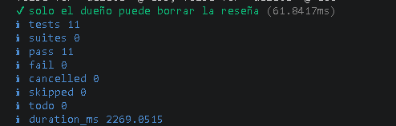
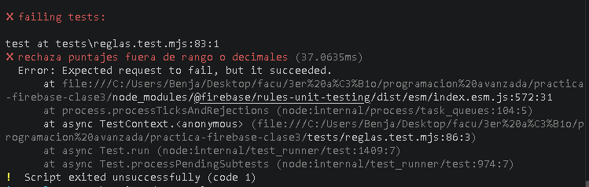

# Reflexión sobre Cloud Firestore

## 1. ¿Por qué usar el UID como ID del documento de reseña?

La ruta `cursos/{cursoId}/resenas/{uid}` permite como máximo una reseña por usuario y curso:
guardar otra vez sobre el mismo documento edita la reseña en vez de crear una duplicada.
Además, las reglas comparan el UID autenticado con el ID del documento sin confiar en un campo
de identidad que el cliente podría modificar.

## 2. ¿Qué aporta un listener en tiempo real frente a consultar periódicamente?

`onSnapshot` notifica cambios y los refleja en la interfaz sin recargar la página ni repetir
consultas periódicas. Esto mejora la experiencia cuando otras personas publican o modifican
reseñas. Hay que desuscribirse del listener al desmontar el componente y contemplar errores de
conexión.

## 3. ¿Por qué obtener el conteo y el promedio con una agregación del servidor?

La agregación evita descargar todos los documentos únicamente para calcular esos valores.
Firestore devuelve `count` y `average`; el resultado no es un listener en tiempo real, por lo
que la interfaz vuelve a consultarlo cuando cambia la lista de reseñas.

## 4. ¿Por qué permitir lectura pública pero exigir autenticación para escribir?

Las reseñas y sus puntajes están pensados para que cualquier visitante consulte la opinión
sobre los cursos. Escribir o borrar modifica datos compartidos, por lo que requiere una sesión
autenticada y que el UID coincida con el ID del documento. Las reglas validan los datos en el
servidor; la interfaz por sí sola no es una frontera de seguridad.

## 5. ¿Para qué se necesita el índice compuesto?

La consulta combina un filtro por puntaje con el orden descendente por fecha. El índice
compuesto declarado en `firestore.indexes.json` permite desplegar esa consulta de manera
reproducible. Si cambia la consulta, hay que comprobar si requiere otro índice.

## 6. ¿Qué valida la suite de reglas y qué no demuestra?

Los tests contra el emulador prueban lectura anónima, escritura autenticada propia,
suplantación de otro UID, puntajes inválidos, campos extra, fecha inmutable y borrado ajeno.
Cubren los escenarios incluidos, pero no sustituyen una revisión de seguridad ni demuestran por
sí solos que las reglas y el índice estén desplegados en el proyecto correcto.

## Evidencia de las pruebas de reglas

La ejecución final de `npm run test:reglas` pasó los 11 casos, sin fallos:

También se comprobó que la suite detecta una regresión: al permitir temporalmente un puntaje
de 6, falló el test que exige rechazar puntajes fuera de rango. Luego se restauró el máximo a 5
y se repitió la suite con los 11 casos aprobados.

