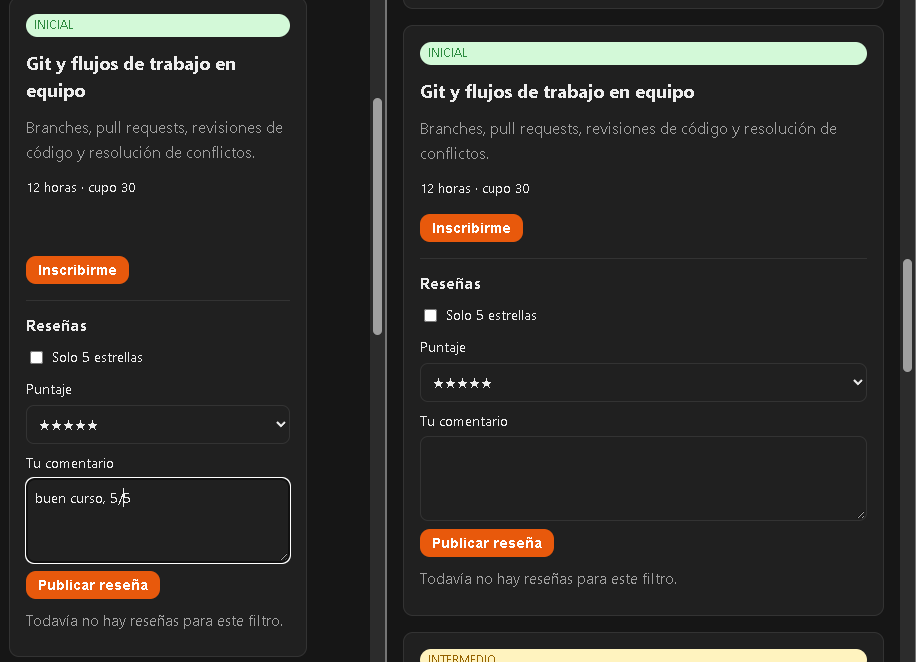
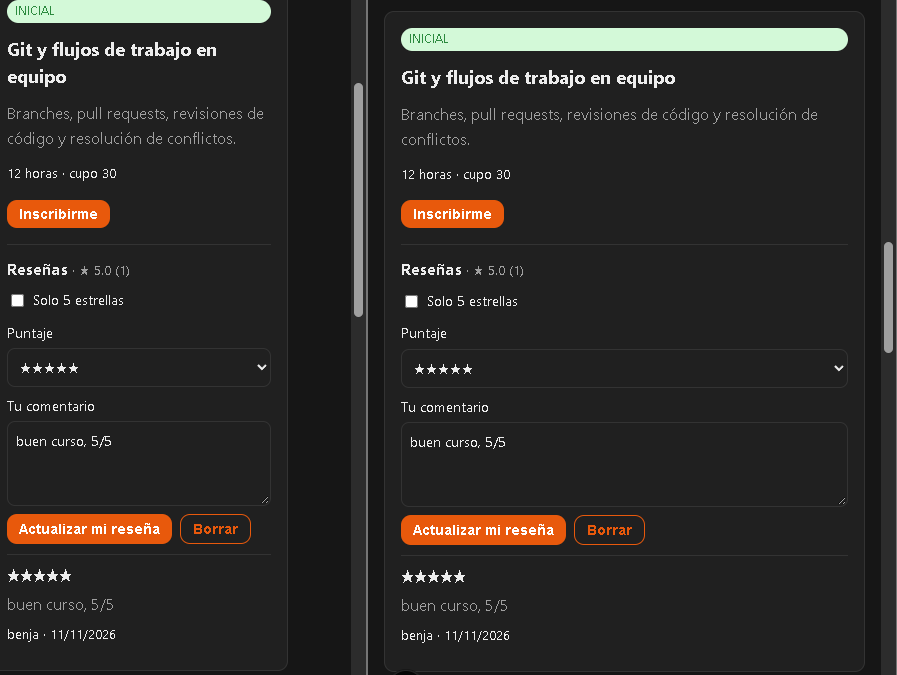

# Evidencias de la práctica de Cloud Firestore

## Pruebas de Security Rules

Comando: `npm run test:reglas` (Node 26.12.1 y Temurin Java 21.0.13).

Resultado documentado:

```text
tests 11
pass 11
fail 0
Script exited successfully (code 0)
```

Los casos incluyen lectura pública, creación con identidad propia, rechazo de escritura sin
login, suplantación de UID, puntajes inválidos, campos no permitidos, fecha del servidor e
inmutable, protección del documento padre, validación al editar y borrado solo por el dueño.
Una regresión temporal que permitía puntaje 6 fue detectada por la suite; restaurado el límite
a 5, la ejecución final pasó con 11 pruebas aprobadas.

## Smoke test de la interfaz

En `http://localhost:3000/cursos`, con Auth y Firestore emulados, se creó una cuenta temporal,
se publicó una reseña y se comprobó el promedio/conteo, la edición, el filtro de 5 estrellas y
el borrado. Los datos se escribieron únicamente en los emuladores locales.

## Actualización en tiempo real entre dos navegadores

Se mantuvo abierto el mismo curso en dos navegadores. Antes de publicar, uno tenía el formulario
preparado y el otro todavía mostraba que no había reseñas. Después de publicar, la reseña apareció
en ambos sin recargar la segunda ventana.





## Despliegue anterior

Las reglas y el índice también se habían desplegado al proyecto anterior `practica-firebase-a8e3e`.
El índice compuesto `puntaje ASCENDING + creadaEn DESCENDING` llegó a `READY`. Ese registro es
histórico y no corresponde al proyecto de la entrega actual.

## Proyecto actual: `practica-firebase-clase-3`

El 11 de noviembre de 2026 se registró la app web, se habilitó el proveedor Correo
electrónico/contraseña y se creó la base Firestore (Standard, `southamerica-east1`).

Se ejecutó:

```text
npx firebase deploy --only firestore:rules,firestore:indexes --project practica-firebase-clase-3 --non-interactive
```

La CLI confirmó que las reglas compilaron, fueron publicadas y el índice se desplegó
correctamente en `(default)`.

## Hosting en el proyecto actual

Se ejecutaron `npm run build` y:

```text
npx firebase deploy --only hosting --project practica-firebase-clase-3 --non-interactive
Deploy complete!
Hosting URL: https://practica-firebase-clase-3.web.app
```

La página de inicio y `/cursos` respondieron HTTP 200; `/cursos` incluyó el título “Cursos
disponibles”. En el navegador se mostraron los 7 cursos y la lectura pública devolvió el estado
vacío de reseñas, sin errores de permisos. El formulario de registro también se renderiza.

Todavía no se creó un usuario ni se escribió una reseña de prueba en producción; queda comprobar
el registro/inicio de sesión y el ciclo de crear, editar y borrar una reseña.
